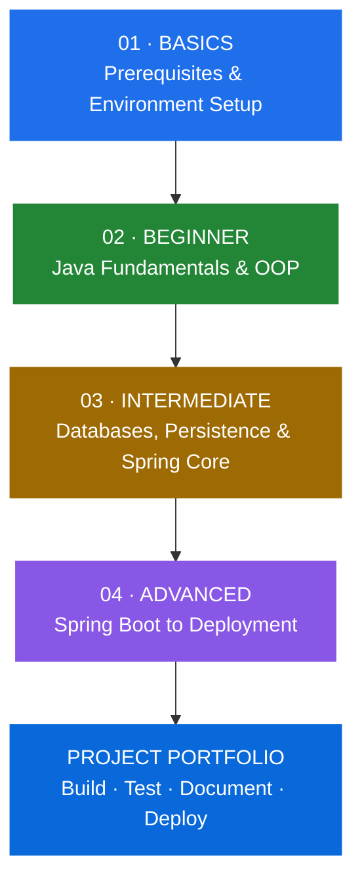

<div align="center">

# Spring Roadmap 2027

### A Structured Learning Path to Java Backend Development

**From programming fundamentals to building, securing, and deploying production-ready applications with Spring Boot.**

<p>
  
  
  
</p>

[Explore the Roadmap](#-the-learning-journey) •
[Browse Projects](#-practical-projects) •
[Study Guides](#-help--study-guides)

</div>

---

## About This Repository

**Spring Roadmap 2027** is a structured learning path for anyone who wants to become a Java Backend Developer and build a strong foundation in the Spring ecosystem.

The roadmap is organized into progressive levels. Each level introduces concepts in a deliberate order, provides curated learning resources, and connects the theory to practical project work.

The journey starts with the tools and fundamentals needed for Java development, moves through Core Java, databases, persistence, and Spring Core, and then progresses to Spring Boot, REST APIs, application security, testing, Docker, and deployment.

> **The goal is not to collect courses or finish videos. The goal is to understand the concepts, apply them in code, and become capable of building backend applications independently.**

---

## The Learning Journey

The roadmap is divided into four stages. Follow them in order because each stage builds on the knowledge gained in the previous one.



### Roadmap at a Glance

| Stage | Main Focus | What You Will Learn | Go to Stage |
|:---:|---|---|:---:|
| **01 · Basics** | Preparation | Java ecosystem, JDK, IntelliJ IDEA, Git, Maven, HTTP, JSON/XML, and networking fundamentals. | [Open →](Basics/README.md) |
| **02 · Beginner** | Java Foundations | Java syntax, OOP, Core Java, Collections, problem solving, SOLID, clean code, and testing fundamentals. | [Open →](Beginner/README.md) |
| **03 · Intermediate** | Data & Spring Core | Database design, SQL, JDBC, JPA, Hibernate, ORM, IoC, Dependency Injection, and Spring Beans. | [Open →](Intermediate/README.md) |
| **04 · Advanced** | Backend Engineering | Spring Boot, REST APIs, Spring Data JPA, validation, architecture, security, JWT, testing, API documentation, Docker, and deployment. | [Open →](Advanced/README.md) |

---

## Levels & Learning Objectives

<details>
<summary><strong>01 · Basics — Prepare Your Development Environment</strong></summary>

Start by setting up the tools and understanding the concepts you will encounter throughout the roadmap.

**Main areas:**
- Java and JVM introduction.
- JDK and IntelliJ IDEA setup.
- Git and GitHub fundamentals.
- Maven basics.
- HTTP, HTTPS, and DNS.
- JSON and XML.
- Networking fundamentals.

**Expected outcome:** A working Java development environment and a basic understanding of how web applications communicate.

[Open Basics →](Basics/README.md)

</details>

<details>
<summary><strong>02 · Beginner — Build Strong Java Foundations</strong></summary>

Develop the programming skills needed to write and organize Java applications.

**Main areas:**
- Java Fundamentals.
- Object-Oriented Programming.
- Core Java and Advanced Fundamentals.
- Collections Framework and Generics.
- Lambda Expressions and Stream API.
- Data Structures and Algorithms.
- SOLID Principles.
- Clean Code.
- Unit Testing Fundamentals.

**Expected outcome:** The ability to write structured Java programs, apply OOP principles, work with Core Java APIs, and solve programming problems.

[Open Beginner →](Beginner/README.md)

</details>

<details>
<summary><strong>03 · Intermediate — Work with Data and Spring Core</strong></summary>

Learn how Java applications store, retrieve, and manage data, then understand the core mechanisms of the Spring Framework.

**Main areas:**
- Database Fundamentals and SQL.
- Database Design and SQL Practice.
- JDBC.
- ORM, JPA, and Hibernate.
- Entity Mapping and Relationships.
- Persistence Context and Transactions.
- Inversion of Control.
- Dependency Injection.
- Spring Beans and ApplicationContext.
- Spring Configuration.

**Expected outcome:** The ability to design relational databases, connect Java applications to databases, understand ORM, and build applications using Spring Core.

[Open Intermediate →](Intermediate/README.md)

</details>

<details>
<summary><strong>04 · Advanced — Build and Deploy Spring Boot Applications</strong></summary>

Move from Spring fundamentals to complete backend applications that can be tested, secured, containerized, and deployed.

**Main areas:**
- Spring Boot Fundamentals.
- RESTful APIs and Spring MVC.
- Spring Data JPA.
- Validation and Exception Handling.
- Design Patterns and Application Architecture.
- Spring Security.
- JWT and Refresh Tokens.
- Advanced Testing.
- Swagger and OpenAPI.
- Additional Backend Topics.
- Docker and Containerization.
- Deployment and CI/CD.

**Expected outcome:** The ability to design, build, secure, test, document, containerize, and deploy Spring Boot backend applications.

[Open Advanced →](Advanced/README.md)

</details>

---

## Practical Projects

Learning becomes meaningful when you apply concepts to real problems. The `Projects` directory contains a project brief for each major stage.

| Level | Project | Purpose | Project Brief |
|---|---|---|:---:|
| **Beginner** | Library Management System | Apply Java fundamentals, OOP, Collections, and exception handling in a console application. | [View →](Projects/Beginner/README.md) |
| **Intermediate** | Inventory Management System | Apply database design, SQL, JDBC, Hibernate/JPA, and Spring Core. | [View →](Projects/Intermediate/README.md) |
| **Advanced** | E-Commerce REST API | Build, secure, test, document, containerize, and deploy a Spring Boot backend. | [View →](Projects/Advanced/README.md) |

Each project brief describes its purpose, scope, requirements, suggested domain model, business rules, architecture, and documentation expectations.

**Project implementation tasks are intentionally kept separate.** They can be added and expanded as the roadmap evolves.

[Browse All Projects →](Projects/README.md)

---

## Help & Study Guides

Use the `HELP` directory as a companion to the learning levels. It explains how to approach the roadmap and how to get the most value from each stage.

| Guide | What It Covers |
|---|---|
| [Study Guide](HELP/01-STUDY-GUIDE.md) | How to study, organize your learning, practice, and review. |
| [Basics Guide](HELP/02-PREREQUISITES-GUIDE.md) | Preparing your tools and development environment. |
| [Beginner Guide](HELP/03-BEGINNER-GUIDE.md) | Approaching Java, OOP, Core Java, and programming practice. |
| [Intermediate Guide](HELP/04-INTERMEDIATE-GUIDE.md) | Approaching SQL, JDBC, Hibernate, JPA, and Spring Core. |
| [Advanced Guide](HELP/05-ADVANCED-GUIDE.md) | Progressing from Spring Boot fundamentals to deployment. |
| [Project Guide](HELP/06-PROJECT-GUIDE.md) | Planning, implementing, documenting, and reviewing projects. |
| [GitHub Guide](HELP/07-GITHUB-GUIDE.md) | Managing repositories and presenting your work professionally. |

[Open Help Center →](HELP/README.md)

---

## How to Use This Roadmap

For the best learning experience, follow this workflow:

1. **Follow the sequence.** Complete the stages in order instead of jumping directly to advanced framework topics.
2. **Choose a primary resource.** When several resources are listed, start with one. Use alternatives when you need another explanation or deeper coverage.
3. **Code while learning.** Reproduce examples, modify them, and experiment with different solutions.
4. **Practice independently.** Solve exercises without copying a complete solution.
5. **Apply what you learn.** Use the project associated with your current level to connect concepts together.
6. **Review before moving forward.** Make sure you can explain and use the important concepts from the current stage.
7. **Document your work.** Keep notes, record design decisions, and maintain clear GitHub repositories.

### A Note About Learning Resources

- **Required** indicates a core topic or resource that should be covered.
- **Recommended** indicates useful additional learning that strengthens your understanding.
- **Alternative** means you can choose another resource instead of studying every listed course.
- **Additional** means supplementary material for deeper exploration.
- **Paid** identifies resources that require payment or enrollment under paid terms.

You do not need to complete every alternative course. Focus on mastering the learning objectives.

---

## Recommended Learning Principles

<details>
<summary><strong>Understand Before Moving On</strong></summary>

Do not measure progress by the number of videos watched. Move forward when you can explain the concept, implement it, and solve a practical problem using it.

</details>

<details>
<summary><strong>Build Incrementally</strong></summary>

Start with small programs, then gradually build applications with more features and responsibilities. Avoid trying to create a large production system before understanding its foundations.

</details>

<details>
<summary><strong>Learn the Fundamentals Behind the Framework</strong></summary>

Spring Boot makes backend development more productive, but it does not replace the need to understand Java, HTTP, databases, object-oriented design, dependency injection, and application architecture.

</details>

<details>
<summary><strong>Keep Your Projects Understandable</strong></summary>

Write code that you can explain. Use meaningful names, separate responsibilities, handle errors, write tests, and document important decisions.

</details>

<details>
<summary><strong>Check Technology Versions</strong></summary>

Framework APIs and configuration may change between releases. Before following a course, check the Java, Spring Boot, Spring Security, and library versions it uses. Prefer current official documentation when resolving version-specific differences.

</details>

---

## Repository Structure

```text
Spring-Roadmap-2027/
│
├── Basics/
│   └── README.md
│
├── Beginner/
│   └── README.md
│
├── Intermediate/
│   └── README.md
│
├── Advanced/
│   └── README.md
│
├── Projects/
│   ├── README.md
│   ├── Beginner/
│   │   └── README.md
│   ├── Intermediate/
│   │   └── README.md
│   └── Advanced/
│       └── README.md
│
├── HELP/
│   ├── README.md
│   ├── 01-STUDY-GUIDE.md
│   ├── 02-PREREQUISITES-GUIDE.md
│   ├── 03-BEGINNER-GUIDE.md
│   ├── 04-INTERMEDIATE-GUIDE.md
│   ├── 05-ADVANCED-GUIDE.md
│   ├── 06-PROJECT-GUIDE.md
│   └── 07-GITHUB-GUIDE.md
│
└── README.md
```

---

## Final Note

This roadmap is intended to be a structured guide, not a checklist of technologies to memorize. Use it to develop a strong foundation, practice consistently, build meaningful projects, and gradually become more independent as a backend developer.

**Learn the fundamentals. Understand the tools. Build real applications.**

<div align="center">

### START YOUR JOURNEY

[**01 · START WITH BASICS →**](Basics/README.md)

<br>

[Beginner](Beginner/README.md) •
[Intermediate](Intermediate/README.md) •
[Advanced](Advanced/README.md) •
[Projects](Projects/README.md) •
[Help](HELP/README.md)

<br>

**Spring Roadmap 2027**

*Learn • Build • Practice • Improve*

</div>
